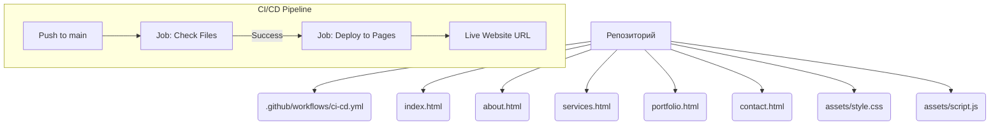
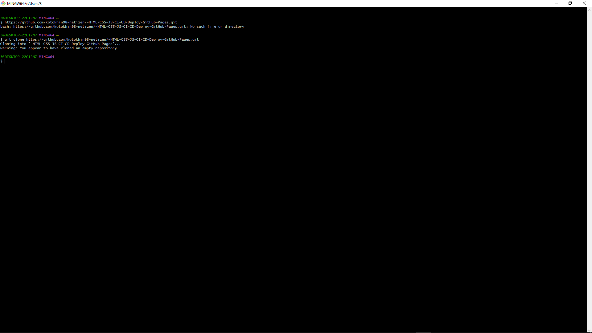
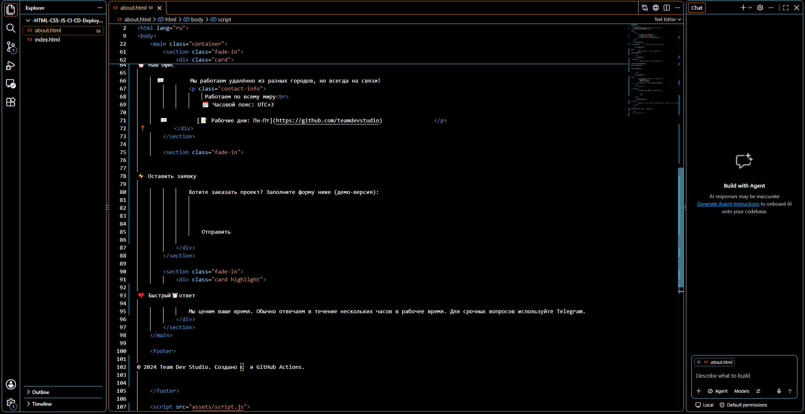
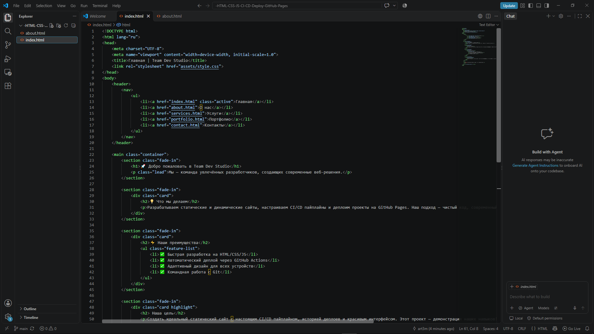
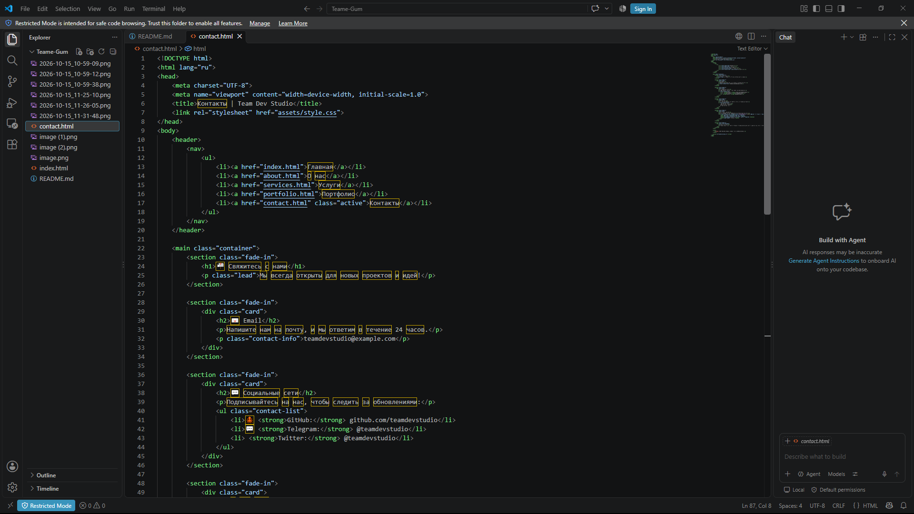
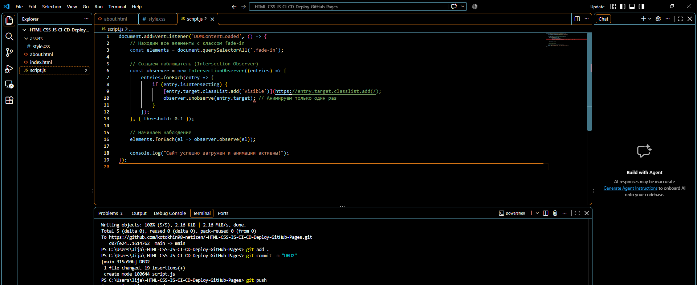
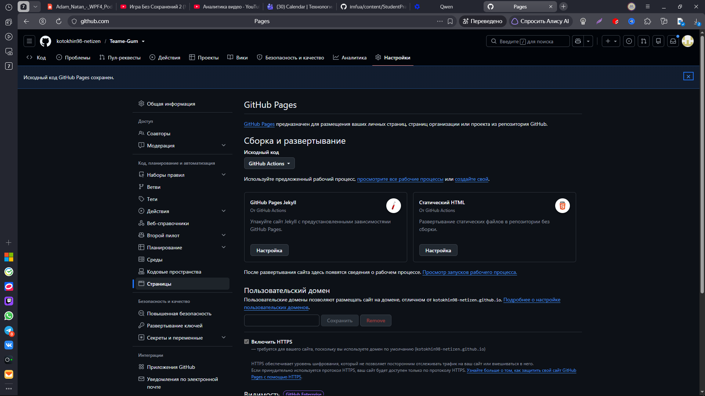
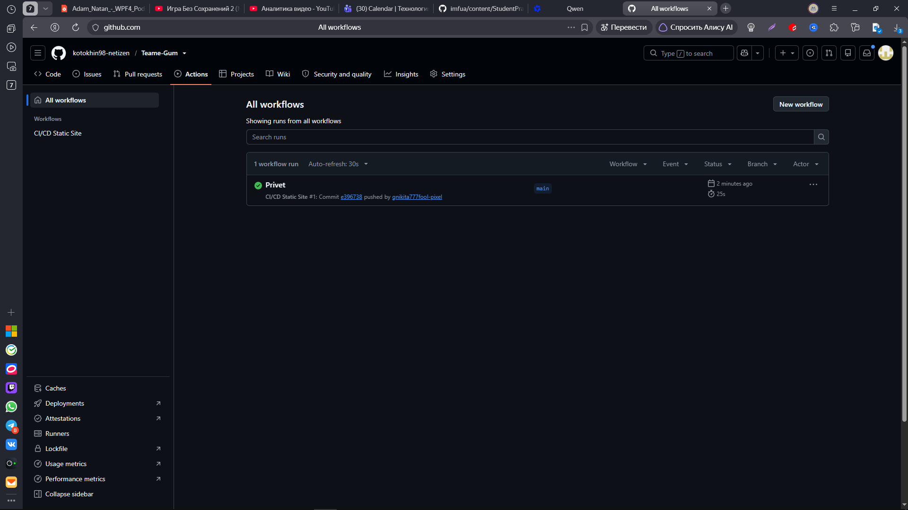
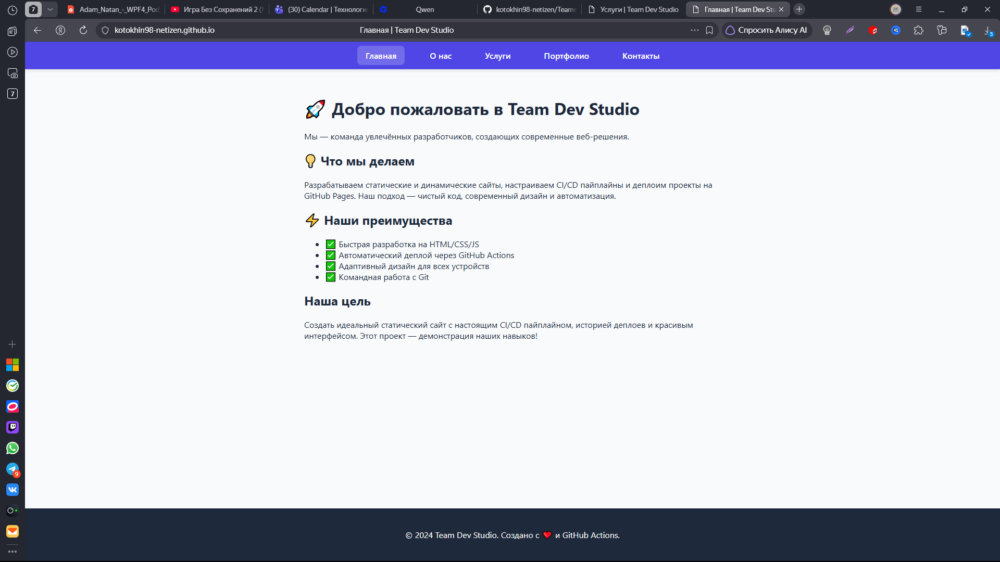

# 🚀 Командный статический сайт (HTML + CSS + JS)

Проект разработан командой из 3-х человек в рамках изучения CI/CD процессов.

## 👥 Состав команды
- **Лидер / Frontend:** [Котохин Артём Ильич] (Главная, О нас)
- **DevOps / Frontend:** [Никита Бакшилов Михайлович] (CI/CD, Услуги, Портфолио)
- **Frontend / Дизайн:** [Ярослав Толстухин Кирилович] (Стили, JS-анимации, Контакты)

## 🌐 Ссылки
- **Живой сайт:** [https://kotokhin98-netizen.github.io/-HTML-CSS-JS-CI-CD-Deploy-GitHub-Pages/](https://kotokhin98-netizen.github.io/-HTML-CSS-JS-CI-CD-Deploy-GitHub-Pages/)
- **Environments:** [Настройки окружения](https://github.com/kotokhin98-netizen/-HTML-CSS-JS-CI-CD-Deploy-GitHub-Pages/settings/environments)
- **Deployments:** [История деплоев](https://github.com/kotokhin98-netizen/-HTML-CSS-JS-CI-CD-Deploy-GitHub-Pages/deployments)

## 📂 Структура проекта

.png)
.png)

